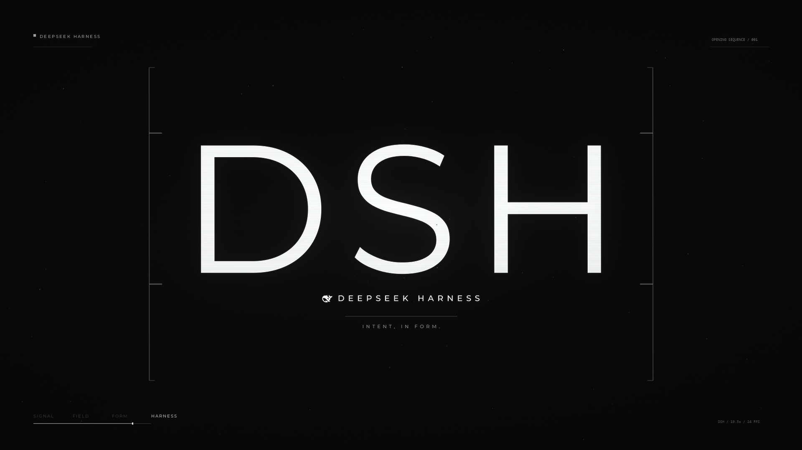

# DSH Opening

把 **《DSH / OPENING — INTENT, IN FORM》** 做成 DeepSeek Harness 的开场动画插件：
应用启动时全屏播放一支 19.5 秒的黑白科幻片头，然后安静地退场。



> “The word is not written. It is woven.”

---

## 特性

- **成片原样播放**：1920×1080 / 30 fps / H.264 + AAC 立体声，19.5 秒；不在浏览器里重绘，也不引用任何外部图片或音频素材。
- **启动自动播放**：每个页面会话一次；新开标签页或重启客户端会再次播放。
- **可跳过**：右上角「跳过 / Skip」，`Esc` 同样有效。
- **声音兜底**：浏览器拒绝带声音自动播放时先静音播放，首次点击即开声。
- **可重播**：设置 → 通用 → 开场动画 → 重新播放。
- **尊重 `prefers-reduced-motion`**：停在海报上，点播放才开始。
- **不会卡住界面**：全屏遮罩自带时长看门狗，媒体异常或 `ended` 丢失时会自动收起。
- **本地流式加载**：Host 用 HTTP Range 提供影片，首帧秒开，不把 30 MB 塞进 JS。

## 安装

要求：DeepSeek Harness 的 web / desktop profile（Host 侧提供 `webServer` 服务）。

```bash
git clone https://github.com/chuyuanguo/dsh-opening.git
```

然后在 Harness 中安装这个本地 bundle（把 `target` 指向克隆下来的目录）：

```js
plugin_manager({
  action: 'install_bundle',
  target: 'C:\\path\\to\\dsh-opening',
})
```

安装会写入当前 profile（包名 `@local/dsh-opening`，本地 bundle，不发布到 npm），对同一 profile 的所有会话生效。安装完成后刷新页面即可看到开场；同一页面会话只会自动播放一次，想再看可用设置里的「重新播放」。

> 插件以目录链接（`link:`）方式挂载，请不要在安装后删除或移动克隆目录。

## 配置

可选文件：`$DSH_HOME/dsh-opening.json`（Windows 通常是 `C:\Users\<你>\.dsh\dsh-opening.json`）。

```json
{
  "frequency": "session",
  "volume": 0.85,
  "allowSkip": true,
  "autoplay": true
}
```

| 字段 | 取值 | 说明 |
|---|---|---|
| `frequency` | `session`（默认）/ `daily` / `once` / `always` | 自动播放的频率 |
| `volume` | `0` – `1` | 初始音量 |
| `allowSkip` | `true` / `false` | 是否显示跳过按钮并允许 `Esc` |
| `autoplay` | `true` / `false` | `false` 时只在设置里手动重播 |

配置文件在每次请求状态时重新读取，改完刷新页面即可生效；没有配置文件时使用默认值。

## 工作原理

插件是一个标准的 Cordis bundle，分 Host 与浏览器两半：

| 文件 | 职责 |
|---|---|
| [`index.js`](index.js) | Host：注册 `/dsh-opening/state.json` 与两条媒体路由（`opening.mp4` / `poster.png`），支持 `HEAD`、`Range`、`ETag`、`304`、`416` |
| [`client.js`](client.js) | 浏览器：向 `shell.overlay` 注册全屏播放器，向 `settings.general.item` 注册重播行 |
| [`cordis.patch.yml`](cordis.patch.yml) | 把 Host 行插入 profile |
| [`locale/`](locale) | 插件管理器的中英文名称与描述 |
| [`icon.svg`](icon.svg) | 原创图标：两条导轨 + 横向织纹 + 中心光点 |
| [`media/`](media) | 发布版成片与海报 |

浏览器半侧通过 Harness 暴露的 `ctx.slots` 与 `ctx.locale` 接入宿主，React 由 Harness 运行时提供；不 import 任何 Harness 客户端包，也不向 `document.body` 追加节点。播放器样式只使用自有类名；设置行使用宿主主题 token（`--dsw-alias-*`），因此浅色/深色主题下都保持宿主样式。

## 自检

```bash
node --check index.js
node --check client.js

# Host 路由（把 <port> 换成当前 Harness 的端口）
curl -s  http://127.0.0.1:<port>/dsh-opening/state.json
curl -sI http://127.0.0.1:<port>/dsh-opening/media/opening.mp4
curl -s -D - -o NUL -H "Range: bytes=0-1023" \
  http://127.0.0.1:<port>/dsh-opening/media/opening.mp4
```

预期：状态请求 `200 application/json`；影片 `200` 且带 `Accept-Ranges: bytes`；
Range 请求 `206` 且 `Content-Range: bytes 0-1023/30645130`；越界 Range 返回 `416`。
`-o NUL` 是 Windows 写法；macOS / Linux 请改成 `-o /dev/null`。

成片 SHA-256：

```
ce215ea478c8fba1d2f19d9a2aa095c4f1dbcb81407725c6ee44924fd2079eee  media/opening-1080p30.mp4
```

## 已知限制

- 只在 Host 提供 `webServer` 的 profile 中工作；如果某个 Electron 外壳用 `file://` + IPC 直接下发前端，没有 HTTP 载体，插件会安静地不挂载。
- 仓库只包含 1080p30 的 Clear 版；4K 24fps 电影版母版未包含，以控制仓库体积。
- 除设置页的重播按钮外没有独立配置界面，选项通过上面的 JSON 文件修改。
- 影片包含 DeepSeek 鲸标与 Montserrat 字体渲染结果，相关声明见 [NOTICE.md](NOTICE.md)。

## 许可

- 插件源码：[MIT](LICENSE)
- 成片与海报：© 2026 chuyuanguo，不适用 MIT；第三方字体与商标声明见 [NOTICE.md](NOTICE.md)
